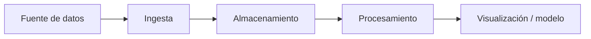

# Proyecto 2 · [Título del proyecto]

> **Plantilla.** Sustituye todo lo que va entre corchetes y borra las indicaciones en cursiva a medida que completes cada sección. Borra también las secciones de bloques que tu proyecto no trabaje.

## Descripción y objetivo

*Dos o tres líneas: qué problema resuelve el proyecto, con qué datos y qué resultado final se obtiene (dashboard, modelo…).*

[Descripción]

## Arquitectura

*Diagrama del pipeline completo. Empieza con uno provisional en el Bloque 0 y actualízalo al terminar cada bloque.*



## Estructura del repositorio

```
bigdata-p2-itaca/
├── data/raw/                 # JSON generados por la ingesta (no versionado)
├── ingesta/
│   ├── ingesta_itaca_bd.py       # PostgreSQL -> data/raw/*.json
│   ├── crear_usuario_lectura.sh  # usuario lectura_bigdata (init de PostgreSQL)
│   └── generar_grupos_sql.py     # grupos.xml (P1) -> grupos.sql
├── etl/
├── dashboard/
├── alumnos.sql, contenidos.sql, calificaciones.sql, cursos.sql, grupos.sql
├── docker-compose.yml
├── .env.example
├── .gitignore
└── README.md
```

## Fuentes de datos

No se dispone de acceso a una réplica real de ITACA, así que se usa la **base de datos de ejemplo** del docente (`alumnos.sql`, `contenidos.sql`, `calificaciones.sql`, `cursos.sql`, cursos 2021-22 a 2025-26). Se carga en un contenedor PostgreSQL 16 (`docker-compose.yml`). La tabla `grupos` no venía en el conjunto de ejemplo y se genera desde los `grupos.xml` de la P1 con `ingesta/generar_grupos_sql.py`.

**Mecanismo de acceso:** conexión directa a PostgreSQL (`localhost:5432`, BD `itaca_academico`) con el driver `psycopg2`, una consulta `SELECT` por tabla.

**Autenticación:** usuario `lectura_bigdata`, con permisos únicamente de `CONNECT` sobre la BD y `SELECT` sobre las tablas del modelo. Lo crea `ingesta/crear_usuario_lectura.sh` al inicializar PostgreSQL. Las credenciales están en `.env` (no versionado; plantilla en `.env.example`).

| Tabla del modelo | Tabla PostgreSQL | Campos extraídos | Actualización esperada |
|---|---|---|---|
| Alumnos | `alumnos` | Anyo, NIA, Curso, Turno, Grupo | Al inicio de curso (matrícula, sep-oct) y con altas/bajas durante el curso |
| Modulos | `contenidos` | Anyo, Curso, Modulo, Nombre_Modulo | Una vez por curso académico |
| Calificaciones | `calificaciones` | Anyo, NIA, Curso, Modulo, Nota, Evaluacion | Tras cada sesión de evaluación (trimestral + ordinaria/extraordinaria) |
| Cursos | `cursos` | Anyo, Codigo, Nombre_Cas, Padre | Una vez por curso académico |
| Grupos | `grupos` | Anyo, Grupo, Nombre, Turno, Modalidad, Aula, Capacidad | Una vez por curso académico |
| Horas | — | — | No existe en la BD de ejemplo |

La tabla `alumnos` de origen contiene además datos personales (nombre, apellidos, documento, fecha de nacimiento, teléfonos, emails, SIP…) que **no se extraen**.

## Puesta en marcha

```bash
cp .env.example .env                   # rellena las credenciales
docker compose up -d                   # MongoDB + PostgreSQL (carga los .sql la primera vez)
docker compose ps

python -m venv .venv
.venv\Scripts\activate                 # Linux/macOS: source .venv/bin/activate
pip install psycopg2-binary python-dotenv pandas
python ingesta/ingesta_itaca_bd.py     # desde la raíz del proyecto
```

## Bitácora de prácticas

### Bloque 1 · P2: Ingesta de datos ITACA (BD relacional)

**Proceso seguido**

1. Carga de la BD de ejemplo en PostgreSQL con Docker: los `.sql` se montan en `/docker-entrypoint-initdb.d/` y se ejecutan la primera vez que arranca el contenedor, seguidos de la creación del usuario de solo lectura.
2. `ingesta/ingesta_itaca_bd.py` se conecta con `lectura_bigdata`, extrae cada tabla con una consulta que selecciona solo los campos del modelo, anonimiza el NIA y guarda un JSON por tabla en `data/raw/<tabla>_<AAAA-MM-DD>.json`.
3. Al final, el script valida los datos generados (sin NIA en claro e integridad de las claves entre tablas).

**Resultado de la primera ingesta (2026-10-28)**

| Fichero | Registros |
|---|---|
| `alumnos_2026-10-28.json` | 7.193 |
| `contenidos_2026-10-28.json` | 1.688 |
| `calificaciones_2026-10-28.json` | 106.814 |
| `cursos_2026-10-28.json` | 413 |
| `grupos_2026-10-28.json` | 257 |

*[Captura de la ejecución del script y del contenido de `data/raw/`]*

**Validación**

| Comprobación | Resultado |
|---|---|
| NIA sin anonimizar | 0 |
| Modulo de Calificaciones existe en Modulos (Modulo+Anyo+Curso) | ✅ 1.265 de 1.265 |
| Curso de Alumnos existe en Cursos (Curso+Anyo) | ✅ 175 de 175 |
| Grupo de Alumnos existe en Grupos (Grupo+Anyo) | ⚠️ 54 alumnos sin grupo (casi todos con matrícula de baja, `estado_matricula = B`) |
| NIA de Calificaciones existe en Alumnos (NIA+Anyo+Curso) | ⚠️ 397 combinaciones (2.180 notas) sin correspondencia: 388 son alumnos matriculados ese año en otro curso (p. ej. módulos pendientes de 1º cursando 2º) y 9 sin matrícula ese año |

Las incidencias son del dato de origen, no de la ingesta. La zona raw conserva los datos tal cual llegan; se tratarán en el ETL.

**Decisiones tomadas**

- **Anonimización del NIA:** SHA-256 truncado a 10 caracteres hex, calculado una sola vez por NIA original (se cachea) y reutilizado en Alumnos y Calificaciones, para que ambas tablas sigan cruzando. Es el mismo hash que en la P1, así que los datos de ambos proyectos son comparables.
- **Minimización de datos:** no se usa `SELECT *`; solo se extraen los campos del modelo, de modo que los datos personales del alumnado nunca salen de la BD.
- **Usuario de solo lectura** con la contraseña tomada de `.env`, no escrita en el código.
- **Grupos** se genera desde los XML de la P1 porque no estaba en la BD de ejemplo. **Horas** queda pendiente: no hay ninguna fuente con esos datos.
- `contenidos` se mantiene con su nombre de origen; corresponde a la tabla Modulos del modelo.
